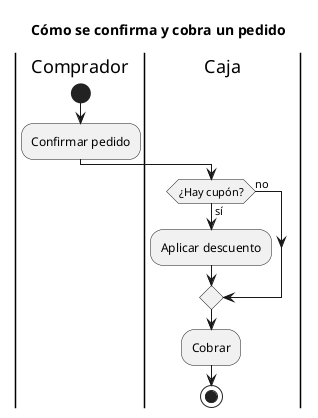

# Diagrama de actividades UML 2

Fuente: OMG UML 2.5.1, Anexo A, diagrama de actividades. Semántica de flujo de tokens.

## Pregunta que responde

Cómo avanza un procedimiento, quién lo hace y dónde se decide.

## Gráfico fácil de leer

Carriles con el responsable, nodo inicial, acciones, una decisión con las dos salidas etiquetadas y un final. Un fork/join solo si hay trabajo en paralelo de verdad.

## Notación de esta versión

- Nodos de acción, nodo inicial, final de actividad, decisión y fusión.
- Flujo de control. Flujo de objeto y pines solo cuando el dato es la pregunta.
- Particiones (carriles) para el responsable.
- No es el activity graph de UML 1: aquí la actividad no es una máquina de estados.

## Render

PlantUML dibuja este diagrama de forma nativa con `start`, acciones, `if` y `stop`.

## Plantilla

`../assets/actividades-v2.puml`. Sustituye los nombres del dominio y conserva la forma.

## Ejemplo

## Prompt de ejemplo

> Dibuja un diagrama de actividades UML 2 con carriles: el comprador confirma el pedido y la caja, si hay cupón, aplica el descuento y en ambos casos cobra.
