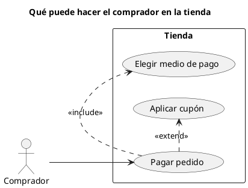

# Diagrama de casos de uso UML 1

Fuente: OMG UML 1.5, diagrama de casos de uso.

## Pregunta que responde

Quién usa el sistema y para qué objetivos.

## Gráfico fácil de leer

Actores fuera de un rectángulo del sistema. De tres a seis elipses. «include» si el caso siempre reutiliza otro. «extend» si la variación es opcional. El flujo paso a paso no va dentro de la elipse.

## Notación de esta versión

- Actor, caso de uso y frontera del sistema.
- Asociación actor-caso.
- «include», «extend» y generalización.
- El texto del caso de uso lo escribe el plugin adrenaline-project-manager. Este diagrama solo muestra actores, fronteras y objetivos.

## Render

PlantUML dibuja este diagrama de forma nativa.

## Plantilla

`../assets/casos-de-uso-v1.puml`. Sustituye los nombres del dominio y conserva la forma.

## Ejemplo

## Prompt de ejemplo

> Dibuja un diagrama de casos de uso UML 1: el comprador paga un pedido. Pagar siempre incluye elegir el medio de pago y opcionalmente se extiende con aplicar un cupón.
