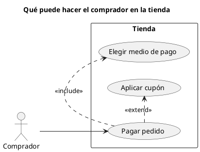

# Diagrama de casos de uso UML 2

Fuente: OMG UML 2.5.1, Anexo A, diagrama de casos de uso. El marco puede llevar el encabezado uc.

## Pregunta que responde

Quién usa el sistema y para qué objetivos.

## Gráfico fácil de leer

Actores fuera del sujeto. De tres a seis elipses. «include» para reutilización obligatoria y «extend» para variación opcional. Sin pasos de flujo dentro de la elipse.

## Notación de esta versión

- Actor, caso de uso y sujeto (la frontera).
- Asociación, «include», «extend» y generalización.
- El encabezado de marco `uc` es propio de UML 2. PlantUML no dibuja ese marco; el título ocupa su lugar y la entrega lo dice.
- El texto del caso de uso pertenece a adrenaline-project-manager.

## Render

PlantUML dibuja actores, casos y relaciones de forma nativa. El marco con encabezado uc no se dibuja; el título lo sustituye y hay que decirlo.

## Plantilla

`../assets/casos-de-uso-v2.puml`. Sustituye los nombres del dominio y conserva la forma.

## Ejemplo

## Prompt de ejemplo

> Dibuja un diagrama de casos de uso UML 2 de la tienda: el comprador paga un pedido, siempre elige el medio de pago y puede extender el pago con un cupón.
