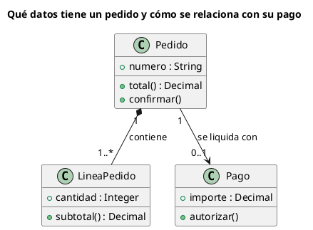

# Diagrama de clases UML 1

Fuente: OMG UML 1.5, diagrama de clases.

## Pregunta que responde

Qué conceptos hay y cómo se relacionan, con la notación de clases de UML 1.

## Gráfico fácil de leer

De tres a seis cajas de tres compartimentos. Asociaciones con multiplicidad y un nombre verbal. Como mucho una generalización. Agregación o composición solo cuando el todo y la parte sean la pregunta.

## Notación de esta versión

- Caja con nombre, atributos y operaciones.
- Asociación, agregación (rombo hueco), composición (rombo relleno), dependencia y generalización.
- Multiplicidad en los extremos.
- Esta versión no pone puertos ni partes internas en la clase. Eso es estructura compuesta de UML 2.

## Render

PlantUML dibuja este diagrama de forma nativa.

## Plantilla

`../assets/clases-v1.puml`. Sustituye los nombres del dominio y conserva la forma.

## Ejemplo

## Prompt de ejemplo

> Dibuja un diagrama de clases UML 1 del pedido: un pedido contiene una o más líneas y se liquida con un pago opcional. Muestra solo numero, total, cantidad, subtotal e importe, y las operaciones confirmar, subtotal y autorizar.
