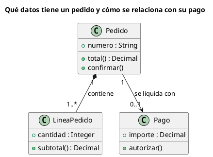

# Diagrama de clases UML 2

Fuente: OMG UML 2.5.1, Anexo A, diagrama de clases.

## Pregunta que responde

Qué conceptos hay y cómo se relacionan.

## Gráfico fácil de leer

De tres a seis cajas de tres compartimentos. Asociaciones con multiplicidad y un verbo. Como mucho una generalización. El rombo relleno solo si la parte no sobrevive sin el todo.

## Notación de esta versión

- Caja con nombre, atributos y operaciones.
- Asociación, agregación, composición, dependencia, generalización y realización.
- Multiplicidad y rol en los extremos cuando cambian la lectura.
- Los puertos y las partes internas van en estructura compuesta, no aquí.

## Render

PlantUML dibuja este diagrama de forma nativa.

## Plantilla

`../assets/clases-v2.puml`. Sustituye los nombres del dominio y conserva la forma.

## Ejemplo

## Prompt de ejemplo

> Dibuja un diagrama de clases UML 2 del pedido: composición con líneas de pedido y asociación opcional con el pago. Solo los atributos y operaciones que hacen falta para leer el total y autorizar el pago.
