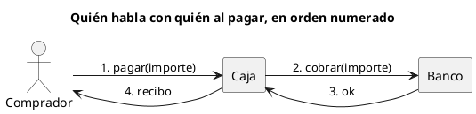

# Diagrama de colaboración UML 1

Fuente: OMG UML 1.5, diagrama de colaboración. En UML 2 este diagrama se llama comunicación.

## Pregunta que responde

Quién está conectado con quién y en qué orden se envían los mensajes.

## Gráfico fácil de leer

De tres a cinco nodos en horizontal y mensajes numerados 1, 2, 3 sobre los enlaces. El número es el orden. Se elige cuando importa la red de enlaces más que la columna de tiempo.

## Notación de esta versión

- Objetos o roles unidos por enlaces.
- Mensajes con número de secuencia junto al enlace.
- Sin fragmentos combinados.
- El nombre de este diagrama en UML 2 es comunicación. Un pedido v1 usa este nombre.

## Render

PlantUML no tiene diagrama de colaboración de primera clase (sigue pedido en el proyecto PlantUML). La entrega usa un grafo con mensajes numerados y lo declara como aproximación de layout, no como marco collaboration nativo.

## Plantilla

`../assets/colaboracion-v1.puml`. Sustituye los nombres del dominio y conserva la forma.

## Ejemplo

## Prompt de ejemplo

> Dibuja un diagrama de colaboración UML 1 del pago: comprador, caja y banco, con los mensajes numerados del escenario feliz.
