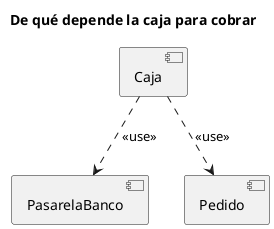

# Diagrama de componentes UML 1

Fuente: OMG UML 1.5, diagrama de componentes.

## Pregunta que responde

Qué componentes hay y de cuáles dependen.

## Gráfico fácil de leer

De tres a cinco componentes y dependencias punteadas con un estereotipo legible. Interfaces solo si la pregunta es qué se cumple, no cómo se despliega.

## Notación de esta versión

- Componente, interfaz, dependencia y realización.
- Sin puertos ni conectores de ensamblaje. Esos son de UML 2.
- El nodo donde se instala va en el diagrama de despliegue.

## Render

PlantUML dibuja componentes y dependencias de forma nativa. En un pedido v1 no se usan portin, portout ni conectores de estructura compuesta.

## Plantilla

`../assets/componentes-v1.puml`. Sustituye los nombres del dominio y conserva la forma.

## Ejemplo

## Prompt de ejemplo

> Dibuja un diagrama de componentes UML 1: la caja depende de la pasarela del banco y del pedido. Sin puertos.
