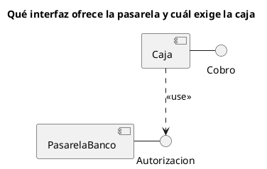

# Diagrama de componentes UML 2

Fuente: OMG UML 2.5.1, Anexo A, diagrama de componentes.

## Pregunta que responde

Qué componentes se ensamblan y qué interfaces ofrecen o exigen.

## Gráfico fácil de leer

De dos a cuatro componentes. Interfaz provista como piruleta e interfaz requerida explícita. Un ensamblaje por pregunta, no el mapa de todo el sistema.

## Notación de esta versión

- Componente, interfaz provista, interfaz requerida y dependencia de uso.
- Puerto y conector de ensamblaje cuando la frontera del componente importa.
- Esas piezas no se copian a un diagrama de componentes UML 1.

## Render

PlantUML dibuja componentes e interfaces de forma nativa. La piruleta se aproxima con la interfaz unida por línea sólida al componente que la provee y dependencia punteada del que la exige.

## Plantilla

`../assets/componentes-v2.puml`. Sustituye los nombres del dominio y conserva la forma.

## Ejemplo

## Prompt de ejemplo

> Dibuja un diagrama de componentes UML 2: la caja provee Cobro y usa Autorizacion, que provee la pasarela del banco.
