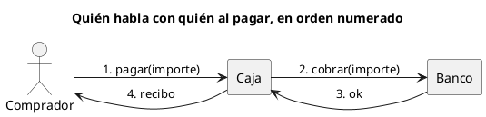

# Diagrama de comunicación UML 2

Fuente: OMG UML 2.5.1, Anexo A. Es el antiguo diagrama de colaboración de UML 1, con otro nombre y marco de interacción.

## Pregunta que responde

Quién está enlazado con quién y en qué orden viajan los mensajes.

## Gráfico fácil de leer

De tres a cinco líneas de vida en horizontal, enlaces y mensajes numerados. Se prefiere a la secuencia cuando la pregunta es la red, no la columna de tiempo.

## Notación de esta versión

- Líneas de vida, conectores y mensajes con número de secuencia.
- El orden lo da el número, no la altura.
- El nombre v1 de este diagrama es colaboración. La semántica de los mensajes numerados se conserva.
- Sin fragmentos combinados en el gráfico fácil. Si hay ramas, el diagrama que las cuenta es la secuencia UML 2.

## Render

PlantUML no tiene diagrama de comunicación de primera clase. La entrega usa un grafo de izquierda a derecha con mensajes numerados y lo declara como aproximación.

## Plantilla

`../assets/comunicacion-v2.puml`. Sustituye los nombres del dominio y conserva la forma.

## Ejemplo

## Prompt de ejemplo

> Dibuja un diagrama de comunicación UML 2 del pago feliz entre comprador, caja y banco, con mensajes numerados.
