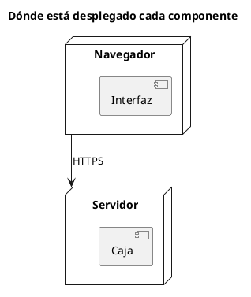

# Diagrama de despliegue UML 1

Fuente: OMG UML 1.5, diagrama de despliegue.

## Pregunta que responde

En qué nodos está cada componente.

## Gráfico fácil de leer

Dos o tres nodos, los componentes dentro del nodo donde corren, y una línea de comunicación entre nodos. Un entorno, el que nombra el título.

## Notación de esta versión

- Nodo, componente desplegado en el nodo y asociación de comunicación.
- El artefacto (`artifact`) es de UML 2. En v1 el componente va dentro del nodo.
- Un diagrama por entorno. Producción y pruebas no comparten el mismo dibujo.

## Render

PlantUML dibuja nodos y componentes de forma nativa.

## Plantilla

`../assets/despliegue-v1.puml`. Sustituye los nombres del dominio y conserva la forma.

## Ejemplo

## Prompt de ejemplo

> Dibuja un diagrama de despliegue UML 1 de producción: la interfaz en el navegador y la caja en el servidor, unidos por HTTPS. Sin artefactos de UML 2.
