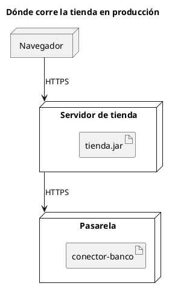

# Diagrama de despliegue UML 2

Fuente: OMG UML 2.5.1, Anexo A, diagrama de despliegue.

## Pregunta que responde

Qué artefactos corren en qué nodos.

## Gráfico fácil de leer

Dos o cuatro nodos, el artefacto dentro del nodo, y el camino de comunicación con su protocolo. Un entorno por diagrama.

## Notación de esta versión

- Nodo, dispositivo o entorno de ejecución, artefacto y camino de comunicación.
- El artefacto es el elemento desplegable de UML 2. El componente suelto dentro del nodo es la lectura de UML 1.
- Manifiestos de despliegue y especificaciones solo si el pedido las nombra.

## Render

PlantUML dibuja este diagrama de forma nativa.

## Plantilla

`../assets/despliegue-v2.puml`. Sustituye los nombres del dominio y conserva la forma.

## Ejemplo

## Prompt de ejemplo

> Dibuja un diagrama de despliegue UML 2 de producción: tienda.jar en el servidor de la tienda, conector-banco en la pasarela, y el navegador habla con el servidor por HTTPS.
