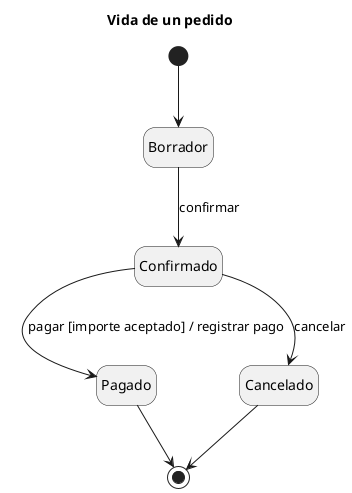

# Diagrama de estados UML 1 (statechart)

Fuente: OMG UML 1.5, statechart. En UML 2 el diagrama se llama máquina de estados.

## Pregunta que responde

Qué vida recorre un solo objeto y qué evento lo hace cambiar.

## Gráfico fácil de leer

Un objeto, de tres a seis estados, estado inicial y final. Cada transición se lee `evento [guarda] / acción`. Sin regiones ortogonales: si dos partes cambian a la vez, son dos máquinas.

## Notación de esta versión

- Estado, estado inicial, estado final y transición.
- Etiqueta `evento [guarda] / acción`.
- Un estado compuesto simple cabe si agrupa una subvida.
- Las regiones ortogonales y la máquina de protocolo son lectura de UML 2. Un pedido v1 no las usa.

## Render

PlantUML dibuja el statechart de forma nativa.

## Plantilla

`../assets/estados-v1.puml`. Sustituye los nombres del dominio y conserva la forma.

## Ejemplo

## Prompt de ejemplo

> Dibuja el statechart UML 1 de un pedido: borrador, confirmado, pagado y cancelado. De confirmado se pasa a pagado solo si el importe es aceptado, y se registra el pago.
