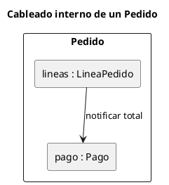

# Diagrama de estructura compuesta UML 2

Fuente: OMG UML 2.5.1, Anexo A, diagrama de estructura compuesta. No existe en el catálogo v1.

## Pregunta que responde

Qué partes tiene un clasificador por dentro y cómo se conectan.

## Gráfico fácil de leer

Un clasificador exterior y de dos a cuatro partes con rol `: Tipo`. Conectores entre partes. Puertos solo en la frontera que el exterior muestra.

## Notación de esta versión

- Parte, puerto y conector.
- La parte se nombra `rol : Tipo`.
- No es un diagrama de clases: no lista el catálogo de tipos, muestra el cableado de uno.

## Render

PlantUML no tiene diagrama de estructura compuesta de primera clase. La entrega usa un contenedor y rectángulos internos como aproximación de partes y conectores, y lo declara.

## Plantilla

`../assets/estructura-compuesta-v2.puml`. Sustituye los nombres del dominio y conserva la forma.

## Ejemplo

## Prompt de ejemplo

> Dibuja la estructura compuesta UML 2 de Pedido: por dentro tiene las partes lineas y pago, y las líneas notifican el total al pago.
