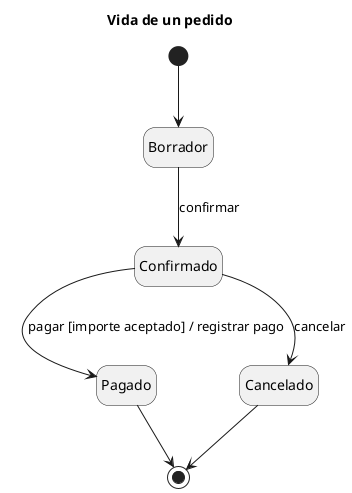

# Diagrama de máquina de estados UML 2

Fuente: OMG UML 2.5.1, Anexo A, diagrama de máquina de estados. En UML 1 el nombre es statechart.

## Pregunta que responde

Qué vida recorre un objeto y qué evento, guarda y efecto cambian su estado.

## Gráfico fácil de leer

Un clasificador, de tres a seis estados, transición `evento [guarda] / efecto`. Regiones solo si dos partes del mismo objeto evolucionan a la vez. Historia `[H]` solo si el pedido exige recordar el subestado.

## Notación de esta versión

- Estado, pseudestado inicial, final y transición.
- Comportamientos entry, do y exit cuando el estado hace algo mientras dura.
- Región ortogonal y estado de historia cuando la vida no es una sola línea.
- Un pedido que diga statechart o estados, sin versión 2, usa la referencia estados-v1.

## Render

PlantUML dibuja la máquina de estados de forma nativa.

## Plantilla

`../assets/maquina-de-estados-v2.puml`. Sustituye los nombres del dominio y conserva la forma.

## Ejemplo

## Prompt de ejemplo

> Dibuja la máquina de estados UML 2 de un pedido, de borrador a confirmado, y de ahí a pagado o cancelado. El paso a pagado exige que el importe sea aceptado y registra el pago.
