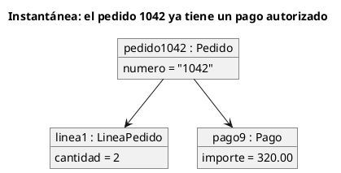

# Diagrama de objetos UML 1

Fuente: OMG UML 1.4 y 1.5. La notación define el diagrama de objetos; el punto de cumplimiento de UML 1.4 no lo separa del de clases.

## Pregunta que responde

Qué valores concretos tienen los objetos en un instante.

## Gráfico fácil de leer

Pocas instancias, nombre subrayado `nombre : Tipo`, ranuras con valores y enlaces. Un solo momento, el que nombra el título.

## Notación de esta versión

- Instancia con el nombre subrayado y el tipo.
- Ranuras `atributo = valor`.
- Enlace entre instancias, sin multiplicidad de clase.
- No es un diagrama de clases con ejemplos escritos en las cajas.

## Render

PlantUML dibuja este diagrama de forma nativa con `object`.

## Plantilla

`../assets/objetos-v1.puml`. Sustituye los nombres del dominio y conserva la forma.

## Ejemplo

## Prompt de ejemplo

> Dibuja un diagrama de objetos UML 1, un instante: el pedido 1042 está pagado, tiene una línea de cantidad 2 y un pago de 320.00.
