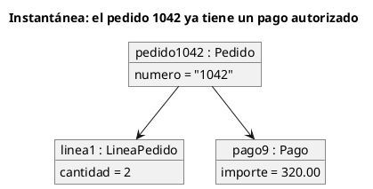

# Diagrama de objetos UML 2

Fuente: OMG UML 2.5.1, Anexo A, diagrama de objetos.

## Pregunta que responde

Qué valores concretos tienen las instancias en un instante.

## Gráfico fácil de leer

Pocas instancias subrayadas, ranuras y enlaces. Un solo momento.

## Notación de esta versión

- Especificación de instancia: nombre subrayado y clasificador.
- Ranuras con valores.
- Enlaces, que son instancias de asociaciones.
- Si hace falta el tipo y no el valor, el diagrama que toca es el de clases.

## Render

PlantUML dibuja este diagrama de forma nativa con `object`.

## Plantilla

`../assets/objetos-v2.puml`. Sustituye los nombres del dominio y conserva la forma.

## Ejemplo

## Prompt de ejemplo

> Dibuja un diagrama de objetos UML 2 del instante en que el pedido 1042 queda ligado a su línea y a un pago de 320.00.
