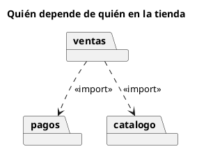

# Diagrama de paquetes UML 2

Fuente: OMG UML 2.5.1, Anexo A, diagrama de paquetes. No existe en el catálogo v1.

## Pregunta que responde

Cómo se agrupa el modelo y qué paquete depende de cuál.

## Gráfico fácil de leer

Carpetas y dependencias punteadas hacia el paquete más estable. Sin ciclos. «import» o «merge» solo si esa es la pregunta.

## Notación de esta versión

- Paquete y dependencia.
- «import» incorpora los nombres visibles. «merge» combina paquetes del mismo nivel conceptual.
- El contenido interno que no cambia la dependencia se omite.

## Render

PlantUML dibuja paquetes dentro del diagrama de clases, que es la forma nativa de este diagrama.

## Plantilla

`../assets/paquetes-v2.puml`. Sustituye los nombres del dominio y conserva la forma.

## Ejemplo

## Prompt de ejemplo

> Dibuja un diagrama de paquetes UML 2: ventas importa pagos y catálogo, y no hay ciclos.
