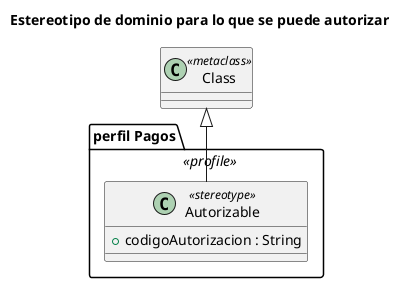

# Diagrama de perfiles UML 2

Fuente: OMG UML 2.5.1, Anexo A, diagrama de perfiles. Entra en UML 2 desde 2.2. No existe en el catálogo v1.

## Pregunta que responde

Qué estereotipo extiende qué metaclas, y con qué etiquetas.

## Gráfico fácil de leer

Un paquete «profile», un estereotipo y una metaclas. La flecha de extensión apunta a la metaclas. Una o dos etiquetas, las que el dominio va a leer.

## Notación de esta versión

- Perfil, estereotipo, metaclas y extensión.
- Valor etiquetado como atributo del estereotipo.
- No es un diagrama de clases del negocio: las cajas son conceptos del propio UML.

## Render

PlantUML no tiene diagrama de perfiles de primera clase. La entrega usa un paquete estereotipado, una clase «stereotype» y una generalización hacia la metaclas, y lo declara como aproximación de la extensión.

## Plantilla

`../assets/perfiles-v2.puml`. Sustituye los nombres del dominio y conserva la forma.

## Ejemplo

## Prompt de ejemplo

> Dibuja un diagrama de perfiles UML 2: el perfil Pagos define el estereotipo Autorizable, con la etiqueta codigoAutorizacion, extendiendo la metaclas Class.
