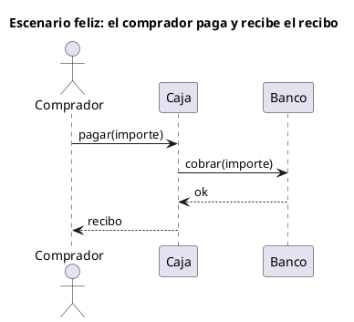

# Diagrama de secuencia UML 1

Fuente: OMG UML 1.5, diagrama de secuencia.

## Pregunta que responde

Qué mensajes se intercambian en un solo escenario, de arriba abajo.

## Gráfico fácil de leer

Actor a la izquierda y dos o tres participantes. Un escenario, el feliz o uno alternativo en otro dibujo. Mensajes síncronos con retorno punteado.

## Notación de esta versión

- Líneas de vida y mensajes en orden temporal, de arriba abajo.
- Mensaje síncrono y retorno.
- Sin fragmentos combinados. alt, opt, loop, par, break y ref son de UML 2.
- Un rechazo u otra rama es otro diagrama de secuencia, con su título.

## Render

PlantUML dibuja la secuencia de forma nativa. Aunque acepte alt, un pedido v1 no lo usa.

## Plantilla

`../assets/secuencia-v1.puml`. Sustituye los nombres del dominio y conserva la forma.

## Ejemplo

## Prompt de ejemplo

> Dibuja el diagrama de secuencia UML 1 del escenario feliz de pagar: el comprador pide el cobro a la caja, la caja lo pide al banco y, si responde ok, la caja devuelve el recibo. Sin fragmentos alt.
