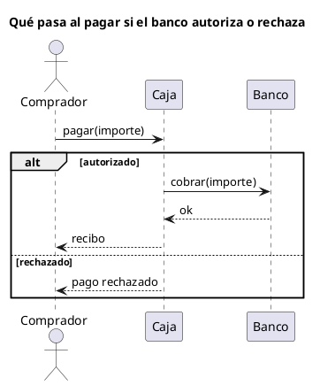

# Diagrama de secuencia UML 2

Fuente: OMG UML 2.5.1, Anexo A, diagrama de secuencia. Los fragmentos combinados están en Interacciones.

## Pregunta que responde

Qué mensajes se intercambian en el tiempo, incluidas las ramas que de verdad importan.

## Gráfico fácil de leer

Actor a la izquierda, dos o tres líneas de vida, lectura de arriba abajo. Un fragmento alt, opt o loop como máximo. El título dice el escenario.

## Notación de esta versión

- Líneas de vida, mensajes síncronos y retornos.
- Fragmentos combinados: alt, opt y loop cubren casi todos los pedidos. par solo si hay paralelismo real.
- Cada operando de alt lleva guarda.
- Un diagrama de secuencia v1 del mismo nombre no lleva estos fragmentos.

## Render

PlantUML dibuja este diagrama de forma nativa, incluidos alt, opt y loop.

## Plantilla

`../assets/secuencia-v2.puml`. Sustituye los nombres del dominio y conserva la forma.

## Ejemplo

## Prompt de ejemplo

> Dibuja un diagrama de secuencia UML 2 de pagar un pedido, con un alt: si el banco autoriza, la caja devuelve el recibo; si rechaza, la caja avisa al comprador.
