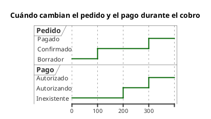

# Diagrama de tiempos UML 2

Fuente: OMG UML 2.5.1, Anexo A, diagrama de tiempos. No existe en el catálogo v1.

## Pregunta que responde

Cuándo cambia el estado o el valor de unas pocas líneas de vida.

## Gráfico fácil de leer

Dos o tres líneas, el tiempo de izquierda a derecha, estados con nombre. Pocos cambios. Se usa cuando la pregunta es el instante del cambio, no la lista de mensajes.

## Notación de esta versión

- Línea de vida y estado o valor a lo largo del eje de tiempo.
- Mensajes entre líneas solo si explican un cambio.
- Restricciones de duración solo si el pedido da números.
- Si la pregunta es quién llama a quién, el diagrama es el de secuencia.

## Render

PlantUML dibuja este diagrama de forma nativa con `robust` y `@tiempo`.

## Plantilla

`../assets/tiempos-v2.puml`. Sustituye los nombres del dominio y conserva la forma.

## Ejemplo

## Prompt de ejemplo

> Dibuja un diagrama de tiempos UML 2: el pedido pasa de borrador a confirmado y luego a pagado, y el pago pasa de inexistente a autorizando y a autorizado en ese último tramo.
