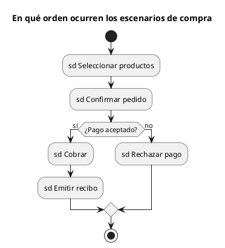

# Diagrama de visión general de la interacción UML 2

Fuente: OMG UML 2.5.1, Anexo A. Interacción es la familia: secuencia, comunicación, tiempos y esta visión. No es un decimoquinto diagrama.

## Pregunta que responde

En qué orden se suceden varios escenarios ya definidos.

## Gráfico fácil de leer

Forma de actividad: inicio, nodos que nombran una interacción (`sd Nombre`), una decisión y un final. Cada nodo es un escenario, no un paso de negocio suelto.

## Notación de esta versión

- Nodos de control como en una actividad, con usos de interacción (`ref`) en los nodos.
- El detalle de mensajes vive en el diagrama de secuencia de ese `sd`.
- No se despliega la secuencia completa dentro de cada nodo.

## Render

PlantUML no tiene marco de visión general de la interacción. La entrega usa una actividad cuyos rótulos empiezan por `sd` y lo declara. Esos rótulos son escenarios, no acciones de un diagrama de actividades.

## Plantilla

`../assets/vision-general-interaccion-v2.puml`. Sustituye los nombres del dominio y conserva la forma.

## Ejemplo

## Prompt de ejemplo

> Dibuja la visión general de la interacción UML 2 de una compra: seleccionar productos, confirmar el pedido y, si el pago se acepta, cobrar y emitir recibo; si no, rechazar el pago. Cada nodo es un escenario sd.
