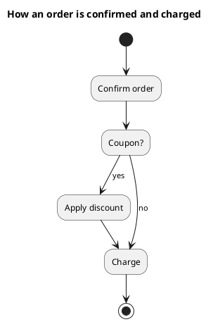
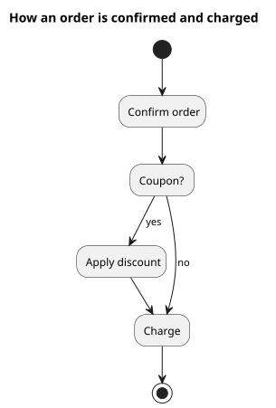

# UML 1 activity graph

Source: OMG UML 1.4 and 1.5. In the UML 1.4 compliance points it is listed as an activity graph.

## Question it answers

In what order the steps of a procedure happen, and where it branches.

## Diagram that is easy to read

An initial state, actions as states, one decision with both exits labeled, and a final state. Swimlanes only when there are two clear owners.

## Notation for this version

- Action states and transitions, because in UML 1 an activity is a form of state machine.
- A decision is transitions with guards, not a free-standing control node.
- No pins, object nodes, or token flow. That is UML 2.
- UML 1 concurrency, when it is needed, is a fork/join pair, not several token flows.

## Render

PlantUML draws the graph with the old `(*)` syntax and quoted actions. That is the syntax for this request, not `start` / `if` / `stop`.

## Template

`../assets/activities-v1.puml`. Replace the domain names and keep the shape.

## Example

## Example prompt

> Draw a UML 1 activity graph to confirm and charge: if there is a coupon the discount is applied, and in both cases the order is charged. Use action-state syntax, not UML 2 token syntax.
