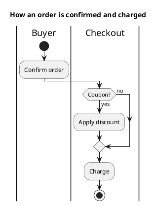
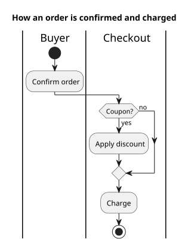

# UML 2 activity diagram

Source: OMG UML 2.5.1, Annex A, activity diagram. Token-flow semantics.

## Question it answers

How a procedure moves forward, who does it, and where it decides.

## Diagram that is easy to read

Swimlanes with the owner, an initial node, actions, one decision with both exits labeled, and a final node. A fork/join only when there is real parallel work.

## Notation for this version

- Action nodes, initial node, activity final, decision, and merge.
- Control flow. Object flow and pins only when the data is the question.
- Partitions (swimlanes) for the owner.
- This is not the UML 1 activity graph: here an activity is not a state machine.

## Render

PlantUML draws this diagram natively with `start`, actions, `if`, and `stop`.

## Template

`../assets/activities-v2.puml`. Replace the domain names and keep the shape.

## Example

## Example prompt

> Draw a UML 2 activity diagram with swimlanes: the buyer confirms the order and checkout, if there is a coupon, applies the discount, and in both cases charges.
