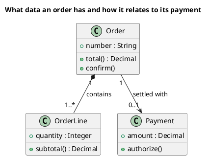

# UML 2 class diagram

Source: OMG UML 2.5.1, Annex A, class diagram.

## Question it answers

What concepts exist and how they relate.

## Diagram that is easy to read

Three to six boxes with three compartments. Associations with multiplicity and a verb. At most one generalization. A filled diamond only if the part does not survive without the whole.

## Notation for this version

- A box with a name, attributes, and operations.
- Association, aggregation, composition, dependency, generalization, and realization.
- Multiplicity and role on the ends when they change the reading.
- Ports and internal parts belong on a composite structure diagram, not here.

## Render

PlantUML draws this diagram natively.

## Template

`../assets/classes-v2.puml`. Replace the domain names and keep the shape.

## Example

## Example prompt

> Draw a UML 2 class diagram of an order: composition with order lines and an optional association with the payment. Only the attributes and operations needed to read the total and authorize the payment.
