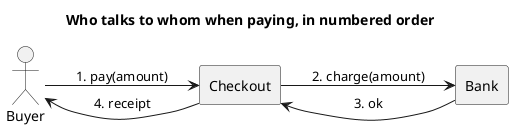

# UML 1 collaboration diagram

Source: OMG UML 1.5, collaboration diagram. In UML 2 this diagram is called communication.

## Question it answers

Who is connected to whom, and in what order the messages are sent.

## Diagram that is easy to read

A guide for choosing what to draw when the user leaves it open. It never removes what the user asked for or approved (see Fidelity in the skill).

Three to five nodes laid out horizontally, with messages numbered 1, 2, 3 on the links. The number is the order. Choose it when the network of links matters more than the time column.

## Notation for this version

- Objects or roles joined by links.
- Messages with a sequence number next to the link.
- No combined fragments.
- The UML 2 name of this diagram is communication. A v1 request uses this name.

## Render

PlantUML has no first-class collaboration diagram (it remains an open PlantUML request). The delivery uses a graph with numbered messages and declares it as a layout approximation, not as a native collaboration frame.

## Template

`../assets/collaboration-v1.puml`. Replace the domain names and keep the shape.

## Example




## Examples

Short command. The command already fixes the diagram, so a few words of domain are enough. The agent fills in what you leave open.

```text
/uml-collaboration-v1 Paying an order.
```

Command. It fixes the diagram. The rest is the domain.

```text
/uml-collaboration-v1 Buyer, checkout, and bank, with the numbered messages of the happy path.
```

Prompt. The sentence names the diagram, and the skill chooses this reference.

```text
Draw a UML 1 collaboration diagram of the payment: buyer, checkout, and bank, with the numbered messages of the happy path.
```
