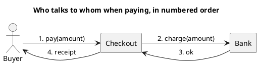

# UML 2 communication diagram

Source: OMG UML 2.5.1, Annex A. This is the old UML 1 collaboration diagram, with another name and an interaction frame.

## Question it answers

Who is linked to whom, and in what order the messages travel.

## Diagram that is easy to read

A guide for choosing what to draw when the user leaves it open. It never removes what the user asked for or approved (see Fidelity in the skill).

Three to five lifelines laid out horizontally, links, and numbered messages. Prefer it to sequence when the question is the network, not the time column.

## Notation for this version

- Lifelines, connectors, and messages with a sequence number.
- The order comes from the number, not from the height.
- The v1 name of this diagram is collaboration. The semantics of the numbered messages stay.
- No combined fragments in the easy-to-read diagram. If there are branches, the diagram that tells them is the UML 2 sequence.

## Render

PlantUML has no first-class communication diagram. The delivery uses a left-to-right graph with numbered messages and declares it as an approximation.

## Template

`../assets/communication-v2.puml`. Replace the domain names and keep the shape.

## Example




## Examples

Short command. The command already fixes the diagram, so a few words of domain are enough. The agent fills in what you leave open.

```text
/uml-communication-v2 Paying an order.
```

Command. It fixes the diagram. The rest is the domain.

```text
/uml-communication-v2 Happy-path payment among buyer, checkout, and bank, with numbered messages.
```

Prompt. The sentence names the diagram, and the skill chooses this reference.

```text
Draw a UML 2 communication diagram of the happy-path payment among buyer, checkout, and bank, with numbered messages.
```
