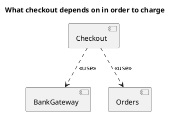
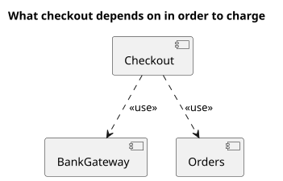

# UML 1 component diagram

Source: OMG UML 1.5, component diagram.

## Question it answers

What components exist and which ones they depend on.

## Diagram that is easy to read

Three to five components and dashed dependencies with a readable stereotype. Interfaces only if the question is what is fulfilled, not how it is deployed.

## Notation for this version

- Component, interface, dependency, and realization.
- No ports and no assembly connectors. Those are UML 2.
- The node where it is installed belongs on the deployment diagram.

## Render

PlantUML draws components and dependencies natively. A v1 request does not use portin, portout, or composite-structure connectors.

## Template

`../assets/components-v1.puml`. Replace the domain names and keep the shape.

## Example

## Example prompt

> Draw a UML 1 component diagram: checkout depends on the bank gateway and on orders. No ports.
