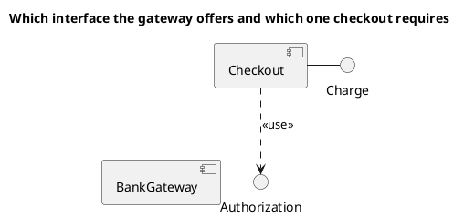
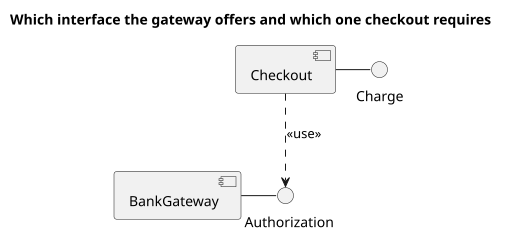

# UML 2 component diagram

Source: OMG UML 2.5.1, Annex A, component diagram.

## Question it answers

What components are assembled, and which interfaces they offer or require.

## Diagram that is easy to read

Two to four components. A provided interface as a lollipop and an explicit required interface. One assembly per question, not a map of the whole system.

## Notation for this version

- Component, provided interface, required interface, and usage dependency.
- Port and assembly connector when the component boundary matters.
- Those pieces are not copied into a UML 1 component diagram.

## Render

PlantUML draws components and interfaces natively. The lollipop is approximated with the interface joined by a solid line to the component that provides it, and a dashed dependency from the one that requires it.

## Template

`../assets/components-v2.puml`. Replace the domain names and keep the shape.

## Example

## Example prompt

> Draw a UML 2 component diagram: checkout provides Charge and uses Authorization, which the bank gateway provides.
