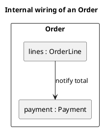

# UML 2 composite structure diagram

Source: OMG UML 2.5.1, Annex A, composite structure diagram. It does not exist in the v1 catalog.

## Question it answers

What parts a classifier has inside, and how they are connected.

## Diagram that is easy to read

A guide for choosing what to draw when the user leaves it open. It never removes what the user asked for or approved (see Fidelity in the skill).

One outer classifier and two to four parts with a role `: Type`. Connectors between parts. Ports only on the boundary the outside shows.

## Notation for this version

- Part, port, and connector.
- A part is named `role : Type`.
- This is not a class diagram: it does not list the catalog of types. It shows the wiring of one classifier.

## Render

PlantUML has no first-class composite structure diagram. The delivery uses a container and inner rectangles as an approximation of parts and connectors, and it declares that.

## Template

`../assets/composite-v2.puml`. Replace the domain names and keep the shape.

## Example




## Examples

Short command. The command already fixes the diagram, so a few words of domain are enough. The agent fills in what you leave open.

```text
/uml-composite-v2 The inside of an order.
```

Command. It fixes the diagram. The rest is the domain.

```text
/uml-composite-v2 Order has the parts lines and payment, and the lines notify the total to the payment.
```

Prompt. The sentence names the diagram, and the skill chooses this reference.

```text
Draw the UML 2 composite structure of Order: inside it has the parts lines and payment, and the lines notify the total to the payment.
```
