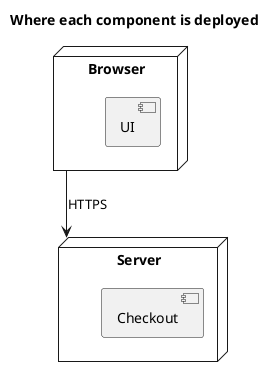
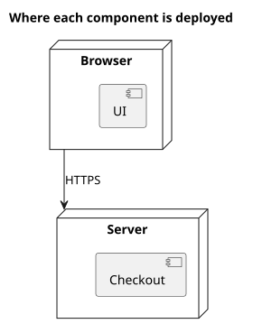

# UML 1 deployment diagram

Source: OMG UML 1.5, deployment diagram.

## Question it answers

On which nodes each component sits.

## Diagram that is easy to read

Two or three nodes, the components inside the node where they run, and a communication line between nodes. One environment, the one named in the title.

## Notation for this version

- Node, component deployed on the node, and communication association.
- The artifact is UML 2. In v1 the component sits inside the node.
- One diagram per environment. Production and test do not share the same drawing.

## Render

PlantUML draws nodes and components natively.

## Template

`../assets/deployment-v1.puml`. Replace the domain names and keep the shape.

## Example

## Example prompt

> Draw a UML 1 deployment diagram of production: the UI in the browser and checkout on the server, joined by HTTPS. No UML 2 artifacts.
