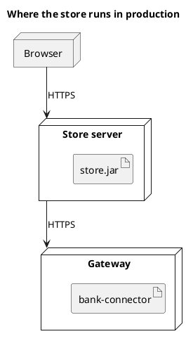

# UML 2 deployment diagram

Source: OMG UML 2.5.1, Annex A, deployment diagram.

## Question it answers

Which artifacts run on which nodes.

## Diagram that is easy to read

A guide for choosing what to draw when the user leaves it open. It never removes what the user asked for or approved (see Fidelity in the skill).

Two to four nodes, the artifact inside the node, and the communication path with its protocol. One environment per diagram.

## Notation for this version

- Node, device or execution environment, artifact, and communication path.
- The artifact is the UML 2 deployable element. A bare component inside the node is the UML 1 reading.
- Deployment manifests and specifications only if the request names them.

## Render

PlantUML draws this diagram natively.

## Template

`../assets/deployment-v2.puml`. Replace the domain names and keep the shape.

## Example




## Examples

Short command. The command already fixes the diagram, so a few words of domain are enough. The agent fills in what you leave open.

```text
/uml-deployment-v2 The store in production.
```

Command. It fixes the diagram. The rest is the domain.

```text
/uml-deployment-v2 Store.jar on the store server, bank-connector on the gateway, and the browser talks to the server over HTTPS.
```

Prompt. The sentence names the diagram, and the skill chooses this reference.

```text
Draw a UML 2 deployment diagram of production: store.jar on the store server, bank-connector on the gateway, and the browser talks to the server over HTTPS.
```
