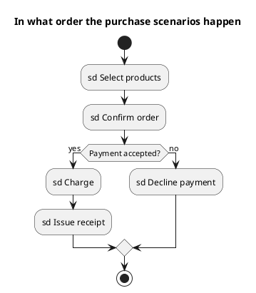
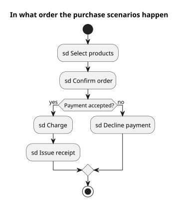

# UML 2 interaction overview diagram

Source: OMG UML 2.5.1, Annex A. Interaction is the family: sequence, communication, timing, and this overview. It is not a fifteenth diagram.

## Question it answers

In what order several already defined scenarios follow one another.

## Diagram that is easy to read

A guide for choosing what to draw when the user leaves it open. It never removes what the user asked for or approved (see Fidelity in the skill).

The shape of an activity: a start, nodes that name an interaction (`sd Name`), one decision, and a stop. Each node is a scenario, not a loose business step.

## Notation for this version

- Control nodes as in an activity, with interaction uses (`ref`) in the nodes.
- The message detail lives in the sequence diagram of that `sd`.
- The full sequence is not expanded inside each node.

## Render

PlantUML has no interaction-overview frame. The delivery uses an activity whose labels start with `sd` and declares that. Those labels are scenarios, not actions of an activity diagram.

## Template

`../assets/interaction-overview-v2.puml`. Replace the domain names and keep the shape.

## Example





## Examples

Short command. The command already fixes the diagram, so a few words of domain are enough. The agent fills in what you leave open.

```text
/uml-interaction-overview-v2 A purchase.
```

Command. It fixes the diagram. The rest is the domain.

```text
/uml-interaction-overview-v2 Select products, confirm the order, and, if the payment is accepted, charge and issue a receipt; otherwise decline the payment. Each node is an sd scenario.
```

Prompt. The sentence names the diagram, and the skill chooses this reference.

```text
Draw the UML 2 interaction overview of a purchase: select products, confirm the order, and, if the payment is accepted, charge and issue a receipt; otherwise decline the payment. Each node is an sd scenario.
```
