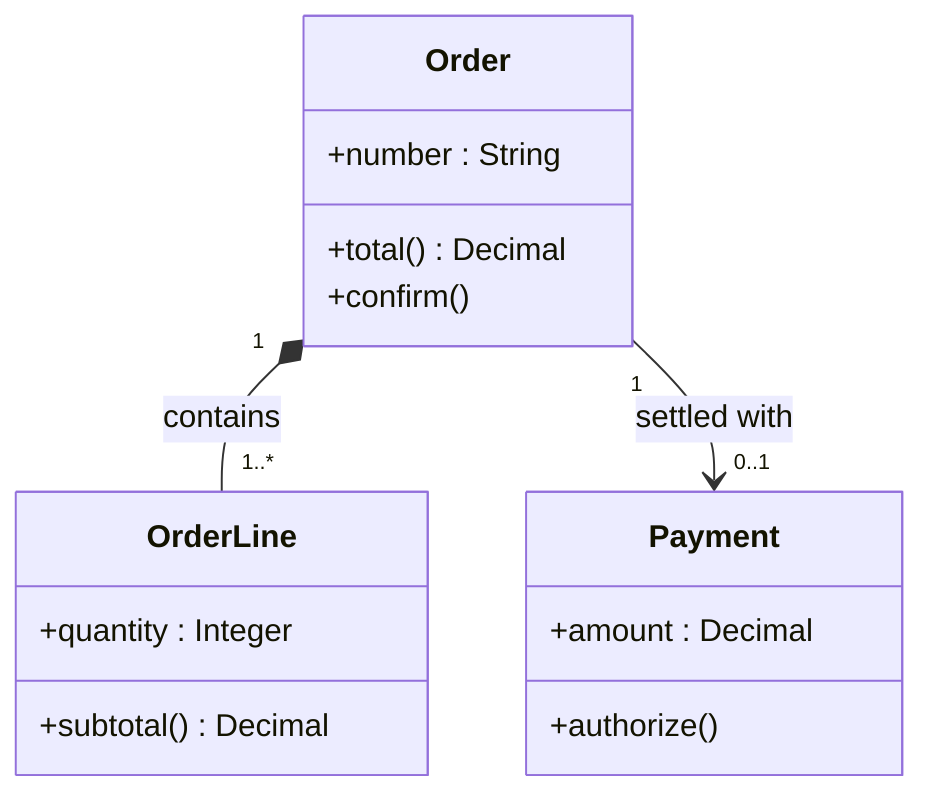
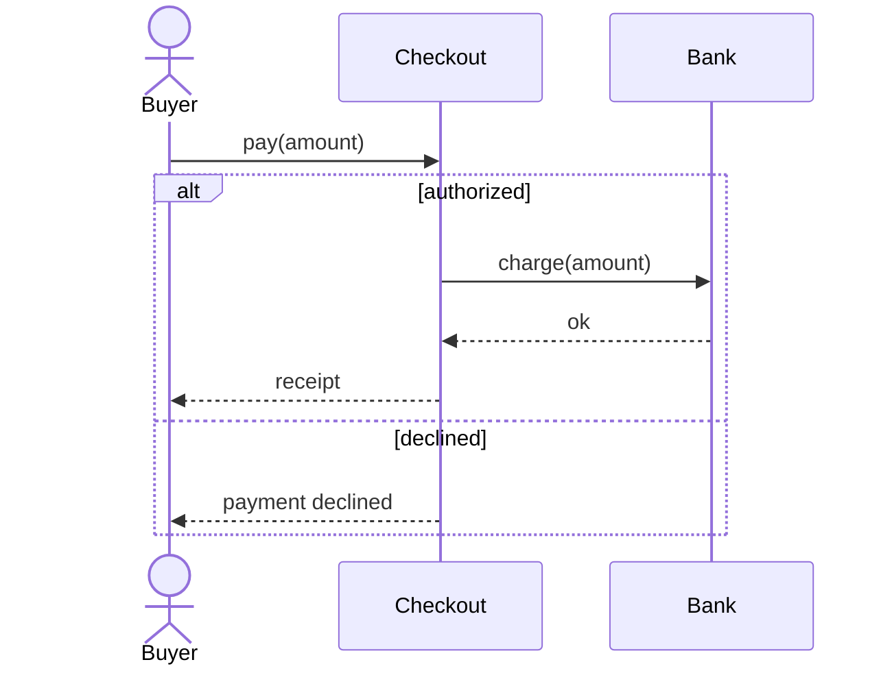
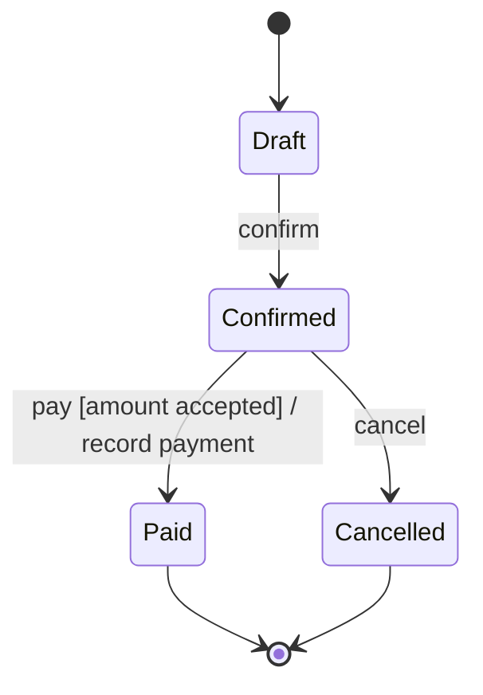

# Mermaid, secondary format

Source: Mermaid 12 syntax for [class](https://mermaid.js.org/syntax/classDiagram.html), [sequence](https://mermaid.js.org/syntax/sequenceDiagram.html), and [state](https://mermaid.js.org/syntax/stateDiagram.html) diagrams. The UML notation still comes from the reference of the type and version.

## When to write it

Mermaid draws only these catalog types natively:

| Id | Mermaid type |
| --- | --- |
| `classes-v1`, `classes-v2` | `classDiagram` |
| `sequence-v1`, `sequence-v2` | `sequenceDiagram` |
| `states-v1`, `state-machine-v2` | `stateDiagram-v2` |

Any other id gets no Mermaid file. Do not approximate a UML diagram with `flowchart`.

Skip it too when the drawing uses an element Mermaid does not have, and name that element in the delivery:

- Sequence: interaction use (`ref`) and gates.
- State: history `[H]`, entry and exit points, and transitions between substates of different composite states.

## File

`<folder>/<id>-<topic>.md`, next to the `.puml` with the same name. It holds the title as a heading and one `mermaid` block. GitHub, GitLab, and Azure DevOps render it without installing anything.

The Mermaid block draws the same elements, names, and relations as the `.puml`. The version rules of the reference still apply:

- `sequence-v1` uses no `alt`, `opt`, `loop`, `par`, `critical`, or `break`.
- `states-v1` uses no concurrent regions (`--`).

## Notation

- Class members are written `+name : Type` and `+operation() Type`. Mermaid draws the return type as `: Type`.
- Multiplicity goes in quotes on each end: `Order "1" *-- "1..*" OrderLine : contains`.
- Synchronous message `->>`, return `-->>`, asynchronous message `-)`.
- State transitions keep the label `event [guard] / effect`.

## Examples

Class diagram, same content as `classes-v2.puml`:

````markdown
# What data an order has and how it relates to its payment


````

Sequence diagram, same content as `sequence-v2.puml`:

````markdown
# What happens when paying if the bank authorizes or declines


````

State machine, same content as `state-machine-v2.puml`:

````markdown
# Life of an order


````
