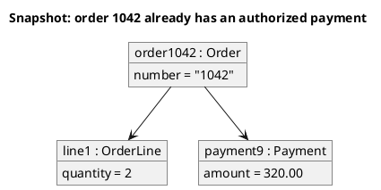

# UML 1 object diagram

Source: OMG UML 1.4 and 1.5. The notation defines the object diagram; the UML 1.4 compliance point does not separate it from the class diagram.

## Question it answers

What concrete values the objects have at one instant.

## Diagram that is easy to read

A guide for choosing what to draw when the user leaves it open. It never removes what the user asked for or approved (see Fidelity in the skill).

A few instances, underlined name `name : Type`, slots with values, and links. One moment, the one named in the title.

## Notation for this version

- An instance with the underlined name and the type.
- Slots `attribute = value`.
- A link between instances, with no class multiplicity.
- This is not a class diagram with examples written inside the boxes.

## Render

PlantUML draws this diagram natively with `object`.

## Template

`../assets/objects-v1.puml`. Replace the domain names and keep the shape.

## Example




## Examples

Short command. The command already fixes the diagram, so a few words of domain are enough. The agent fills in what you leave open.

```text
/uml-objects-v1 One paid order.
```

Command. It fixes the diagram. The rest is the domain.

```text
/uml-objects-v1 Order 1042 is paid, it has one line with quantity 2, and a payment of 320.00.
```

Prompt. The sentence names the diagram, and the skill chooses this reference.

```text
Draw a UML 1 object diagram of one instant: order 1042 is paid, it has one line with quantity 2, and a payment of 320.00.
```
