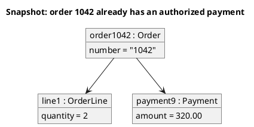

# UML 2 object diagram

Source: OMG UML 2.5.1, Annex A, object diagram.

## Question it answers

What concrete values the instances have at one instant.

## Diagram that is easy to read

A few underlined instances, slots, and links. One moment.

## Notation for this version

- Instance specification: underlined name and classifier.
- Slots with values.
- Links, which are instances of associations.
- If the type is needed and the value is not, the diagram to draw is the class diagram.

## Render

PlantUML draws this diagram natively with `object`.

## Template

`../assets/objects-v2.puml`. Replace the domain names and keep the shape.

## Example

## Example prompt

> Draw a UML 2 object diagram of the instant when order 1042 is linked to its line and to a payment of 320.00.
