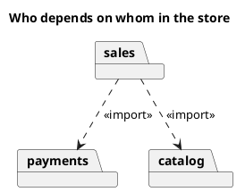

# UML 2 package diagram

Source: OMG UML 2.5.1, Annex A, package diagram. It does not exist in the v1 catalog.

## Question it answers

How the model is grouped, and which package depends on which.

## Diagram that is easy to read

A guide for choosing what to draw when the user leaves it open. It never removes what the user asked for or approved (see Fidelity in the skill).

Folders and dashed dependencies toward the more stable package. No cycles. «import» or «merge» only when that is the question.

## Notation for this version

- Package and dependency.
- «import» brings in the visible names. «merge» combines packages at the same conceptual level.
- Internal content that does not change the dependency is left out.

## Render

PlantUML draws packages inside a class diagram, which is the native form of this diagram.

## Template

`../assets/packages-v2.puml`. Replace the domain names and keep the shape.

## Example




## Examples

Short command. The command already fixes the diagram, so a few words of domain are enough. The agent fills in what you leave open.

```text
/uml-packages-v2 Sales, payments, and catalog.
```

Command. It fixes the diagram. The rest is the domain.

```text
/uml-packages-v2 Sales imports payments and catalog, and there are no cycles.
```

Prompt. The sentence names the diagram, and the skill chooses this reference.

```text
Draw a UML 2 package diagram: sales imports payments and catalog, and there are no cycles.
```
