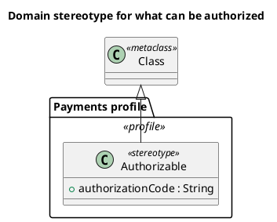

# UML 2 profile diagram

Source: OMG UML 2.5.1, Annex A, profile diagram. It enters UML 2 from 2.2. It does not exist in the v1 catalog.

## Question it answers

Which stereotype extends which metaclass, and with which tags.

## Diagram that is easy to read

One «profile» package, one stereotype, and one metaclass. The extension arrow points at the metaclass. One or two tags, the ones the domain will read.

## Notation for this version

- Profile, stereotype, metaclass, and extension.
- A tagged value is an attribute of the stereotype.
- This is not a business class diagram: the boxes are concepts of UML itself.

## Render

PlantUML has no first-class profile diagram. The delivery uses a stereotyped package, a «stereotype» class, and a generalization toward the metaclass, and it declares that as an approximation of the extension.

## Template

`../assets/profiles-v2.puml`. Replace the domain names and keep the shape.

## Example

## Example prompt

> Draw a UML 2 profile diagram: the Payments profile defines the Authorizable stereotype, with the authorizationCode tag, extending the Class metaclass.
