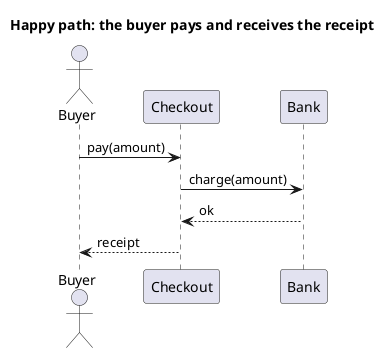

# UML 1 sequence diagram

Source: OMG UML 1.5, sequence diagram.

## Question it answers

What messages are exchanged in a single scenario, top to bottom.

## Diagram that is easy to read

A guide for choosing what to draw when the user leaves it open. It never removes what the user asked for or approved (see Fidelity in the skill).

An actor on the left and two or three participants. One scenario, the happy path or one alternative in a separate drawing. Synchronous messages with a dashed return.

## Notation for this version

- Lifelines and messages in time order, top to bottom.
- Synchronous message and return.
- No combined fragments. alt, opt, loop, par, break, and ref are UML 2.
- A rejection or another branch is another sequence diagram, with its own title.

## Render

PlantUML draws sequence natively. Even if it accepts alt, a v1 request does not use it.

## Template

`../assets/sequence-v1.puml`. Replace the domain names and keep the shape.

## Example




## Examples

Short command. The command already fixes the diagram, so a few words of domain are enough. The agent fills in what you leave open.

```text
/uml-sequence-v1 Paying an order.
```

Command. It fixes the diagram. The rest is the domain.

```text
/uml-sequence-v1 The buyer asks checkout to charge, checkout asks the bank, and if the bank answers ok, checkout returns the receipt. No alt fragments.
```

Prompt. The sentence names the diagram, and the skill chooses this reference.

```text
Draw the UML 1 sequence diagram of the happy path for paying: the buyer asks checkout to charge, checkout asks the bank, and if the bank answers ok, checkout returns the receipt. No alt fragments.
```
