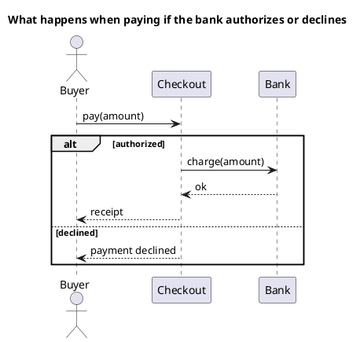

# UML 2 sequence diagram

Source: OMG UML 2.5.1, Annex A, sequence diagram. Combined fragments are specified under Interactions.

## Question it answers

What messages are exchanged over time, including the branches that actually matter.

## Diagram that is easy to read

A guide for choosing what to draw when the user leaves it open. It never removes what the user asked for or approved (see Fidelity in the skill).

An actor on the left, two or three lifelines, read top to bottom. At most one alt, opt, or loop fragment. The title names the scenario.

## Notation for this version

- Lifelines, synchronous messages, and returns.
- Combined fragments: alt, opt, and loop cover almost every request. par only when there is real parallelism.
- Each alt operand has a guard.
- A v1 sequence diagram of the same name does not use these fragments.

## Render

PlantUML draws this diagram natively, including alt, opt, and loop.

## Template

`../assets/sequence-v2.puml`. Replace the domain names and keep the shape.

## Example




## Examples

Short command. The command already fixes the diagram, so a few words of domain are enough. The agent fills in what you leave open.

```text
/uml-sequence-v2 Paying an order.
```

Command. It fixes the diagram. The rest is the domain.

```text
/uml-sequence-v2 Paying an order, with one alt: if the bank authorizes, checkout returns the receipt; if it declines, checkout tells the buyer.
```

Prompt. The sentence names the diagram, and the skill chooses this reference.

```text
Draw a UML 2 sequence diagram of paying an order, with one alt: if the bank authorizes, checkout returns the receipt; if it declines, checkout tells the buyer.
```
