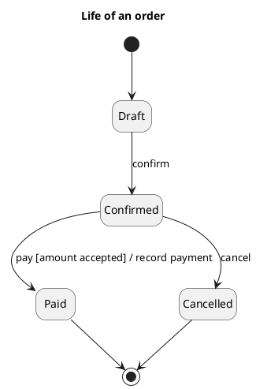

# UML 1 statechart diagram

Source: OMG UML 1.5, statechart. In UML 2 the diagram is called a state machine.

## Question it answers

What life a single object goes through, and which event makes it change.

## Diagram that is easy to read

One object, three to six states, an initial state and a final state. Each transition reads `event [guard] / action`. No orthogonal regions: if two parts change at once, they are two machines.

## Notation for this version

- State, initial state, final state, and transition.
- Label `event [guard] / action`.
- One simple composite state is fine if it groups a sub-life.
- Orthogonal regions and the protocol machine are UML 2. A v1 request does not use them.

## Render

PlantUML draws the statechart natively.

## Template

`../assets/states-v1.puml`. Replace the domain names and keep the shape.

## Example

## Example prompt

> Draw the UML 1 statechart of an order: draft, confirmed, paid, and cancelled. From confirmed it moves to paid only if the amount is accepted, and the payment is recorded.
