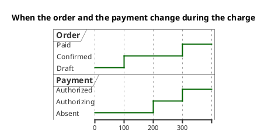
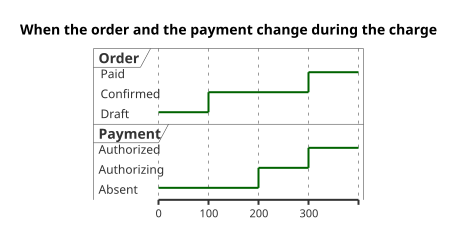

# UML 2 timing diagram

Source: OMG UML 2.5.1, Annex A, timing diagram. It does not exist in the v1 catalog.

## Question it answers

When the state or the value of a few lifelines changes.

## Diagram that is easy to read

Two or three lines, time from left to right, named states. Few changes. Use it when the question is the instant of the change, not the list of messages.

## Notation for this version

- Lifeline and state or value along the time axis.
- Messages between lines only if they explain a change.
- Duration constraints only if the request gives numbers.
- If the question is who calls whom, the diagram is the sequence diagram.

## Render

PlantUML draws this diagram natively with `robust` and `@` time marks.

## Template

`../assets/timing-v2.puml`. Replace the domain names and keep the shape.

## Example

## Example prompt

> Draw a UML 2 timing diagram: the order moves from draft to confirmed and then to paid, and the payment moves from absent to authorizing and to authorized on that last stretch.
