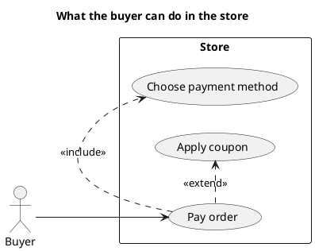

# UML 1 use case diagram

Source: OMG UML 1.5, use case diagram.

## Question it answers

Who uses the system and for which goals.

## Diagram that is easy to read

A guide for choosing what to draw when the user leaves it open. It never removes what the user asked for or approved (see Fidelity in the skill).

Actors outside a system rectangle. Three to six ellipses. «include» when the case always reuses another. «extend» when the variation is optional. The step-by-step flow does not go inside the ellipse.

## Notation for this version

- Actor, use case, and system boundary.
- Actor-to-case association.
- «include», «extend», and generalization.
- The use-case text is written by the adrenaline-project-manager plugin. This diagram shows only actors, boundaries, and goals.

## Render

PlantUML draws this diagram natively.

## Template

`../assets/use-cases-v1.puml`. Replace the domain names and keep the shape.

## Example




## Examples

Short command. The command already fixes the diagram, so a few words of domain are enough. The agent fills in what you leave open.

```text
/uml-use-cases-v1 A buyer paying an order.
```

Command. It fixes the diagram. The rest is the domain.

```text
/uml-use-cases-v1 The buyer pays an order. Paying always includes choosing the payment method, and it is optionally extended by applying a coupon.
```

Prompt. The sentence names the diagram, and the skill chooses this reference.

```text
Draw a UML 1 use case diagram: the buyer pays an order. Paying always includes choosing the payment method, and it is optionally extended by applying a coupon.
```
