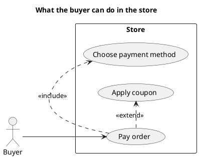

# UML 2 use case diagram

Source: OMG UML 2.5.1, Annex A, use case diagram. The frame may carry the uc heading.

## Question it answers

Who uses the system and for which goals.

## Diagram that is easy to read

Actors outside the subject. Three to six ellipses. «include» for mandatory reuse and «extend» for an optional variation. No flow steps inside the ellipse.

## Notation for this version

- Actor, use case, and subject (the boundary).
- Association, «include», «extend», and generalization.
- The `uc` frame heading belongs to UML 2. PlantUML does not draw that frame; the title takes its place and the delivery says so.
- The use-case text belongs to adrenaline-project-manager.

## Render

PlantUML draws actors, cases, and relationships natively. The frame with a uc heading is not drawn; the title replaces it and that must be said.

## Template

`../assets/use-cases-v2.puml`. Replace the domain names and keep the shape.

## Example

## Example prompt

> Draw a UML 2 use case diagram of the store: the buyer pays an order, always chooses the payment method, and may extend the payment with a coupon.
